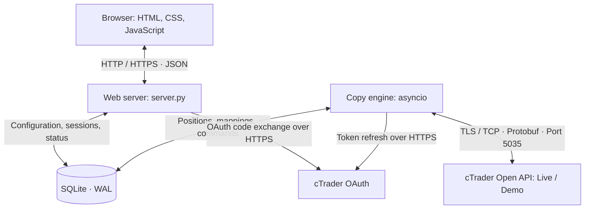

# GIMM · Trade Copier

A self-hosted XAU/USD trade copier built with Python, the cTrader Open API, and a web dashboard. It can copy confirmed position openings directly from one overlord to one master and from there to many slave accounts as the broker and my self-hosted kubernetes infrastructure can support, or relay them through an Overlord --> master --> slaves chain. It then synchronizes stop-loss, take-profit, partial closes, and full closes so everything moves as one.

The project connects a practical trading use case with asynchronous communication, persistent state, authentication, and error handling. A central engineering question is how to keep positions synchronized and traceable when connections fail or broker confirmations do not arrive.

The application sends real trading commands. Without authorized accounts, data views remain empty; no sample trades or invented returns are displayed.

## Purpose and features

Managing several accounts manually requires repeating entries and subsequent changes. The copier handles that transfer and displays the state of each copy. Each destination has its own configurable fixed lot size. Trading decisions originate on the master account, or on the Overlord source when a relay chain is configured; the copier does not implement an entry strategy.

Supported scope: one optional Overlord source, one relay master, multiple slaves, and XAU/USD on hedging accounts. There is no application-level slave-count cap; practical scale depends on cTrader request limits, account authorization, and server capacity.

- cTrader OAuth and account discovery across multiple cTrader IDs.
- Optional two-stage relay: Overlord source → one enabled master account → any number of configured slaves. Each hop uses a confirmed broker account and its own lot setting.
- Confirmed market entries plus mirrored limit, stop and stop-limit orders, with their protection, amendments and cancellations.
- SL/TP synchronization, proportional partial closes, and full closes.
- Detection of manual slave changes and restoration of master SL/TP management.
- Combined portfolio equity and trading return (amount and percentage) since connection, with Berlin-day and period filters; position mappings, connection diagnostics, and activity log.
- Trade journal, equity recording, analytics, and CSV export based on broker data.
- Configurable technical protection rules and an emergency stop.
- Per-slave loss displays that do not trigger trading commands.

## Architecture

**The web server and copy engine run as separate processes.** The web server serves the interface and JSON API, checks sessions, and stores settings and user actions. Only the engine executes trading commands. Closing the browser therefore does not stop synchronization.

The engine processes broker events through an `asyncio.Queue`. Concurrent tasks handle account initialization, position reconciliation, history imports, heartbeats, and protection monitoring. Commands for the same copy run in order; different slaves can be processed concurrently. A local file lock prevents a second engine process from using the same database file.

Both processes exchange state through SQLite, without an additional message broker. SQLite uses WAL and short-lived database connections. This keeps a private single-instance deployment manageable; distributed operation with multiple active engines is not supported.

### Components

| File / directory | Responsibility |
|---|---|
| [`server.py`](server.py) | Python standard-library HTTP server, JSON API, login, CSRF/origin checks, and account configuration |
| [`public/`](public/) | HTML, CSS, and JavaScript without a frontend framework; analytics calculations and presentation |
| [`copier/engine.py`](copier/engine.py) | Account initialization, broker events, position synchronization, reconciliation, and history imports |
| [`copier/transport.py`](copier/transport.py) | TLS connections, Protobuf framing, request correlation, heartbeats, and request budgets |
| [`copier/store.py`](copier/store.py) | Schema, migrations, data access, and filtered dashboard state |
| [`copier/oauth.py`](copier/oauth.py) | Account authorization, code exchange, token encryption, and token management |
| [`copier/safety.py`](copier/safety.py) | Entry checks, persistent protection deadlines, and emergency liquidation |
| [`copier/risk.py`](copier/risk.py) | Loss displays and daily references using the `Europe/Berlin` day boundary |
| [`copier/protocol/`](copier/protocol/) | Spotware Protobuf schemas and generated Python classes |
| [`tests/`](tests/) | Tests with simulated broker responses, DOM tests, and browser tests |

### Lifecycle of a copy

1. The engine authenticates accounts and loads positions, symbol metadata, and broker volume rules. Master positions already open at startup are not copied retroactively.
2. With copying enabled, a newly confirmed Overlord position creates a persistent mapping to the enabled relay master. The confirmed relay account then becomes the source for its enabled slaves. Without an Overlord, the configured master copies directly to slaves. A unique constraint prevents duplicate mappings of the same source position to the same target account.
3. The configured fixed lot size is converted to a valid broker volume. Before sending, the engine checks pause state, safety latches, signal age, and limits.
4. The trading intent is recorded in `commands` and sent through the appropriate live or demo connection. Execution requires a matching broker confirmation.
5. Each confirmed destination position is linked to its mapping. Subsequent upstream changes determine protection prices and target remaining volume. Manual SL/TP overrides are tracked separately for each field.
6. After a restart or disconnection, the engine reconciles stored mappings with broker state. Persistent `gimm:` labels help identify entries that have already executed.

**A timeout does not prove that an order failed.** The broker may already have executed it. Such commands remain stored as `uncertain` and are not blindly resent. Further trading commands for that copy wait for a verifiable state. This reduces the risk of duplicate orders but may require manual investigation.

### Data model

| Tables | Purpose |
|---|---|
| `accounts`, `discovered`, `oauth_tokens` | Account configuration, authorized broker accounts, and encrypted tokens |
| `positions`, `master_positions` | Last known broker state and master reference state |
| `mappings`, `commands` | Master-to-slave mappings and trading intents |
| `deals`, `equity_samples` | Imported executions and equity recorded after connection |
| `settings`, `engine_status`, `audit` | Configuration, process status, and activity records |
| `safety_timers`, `liquidations`, `safety_actions` | Protection deadlines and emergency actions that survive restarts |
| `risk_limits`, `risk_days` | Loss displays and daily references |
| `users`, `sessions`, `oauth_pending` | Administrator access, sessions, and pending authorizations |

### Technical choices

Python with `asyncio` suits the largely network-bound workload. The custom TLS transport uses the bundled Spotware Protobuf classes without an additional cTrader SDK. Each connection has budgets of 40 normal, five emergency, and four historical requests per second, plus heartbeats.

The frontend requires no build step. Node.js and jsdom are used only for development tests. Docker Compose runs the web server and engine separately with shared persistent storage. A Caddy reverse proxy can provide HTTPS.

Access is designed for a private administrator. Passwords use PBKDF2-SHA256 with 600,000 iterations. Sessions are stored server-side, with HttpOnly and SameSite cookies. Write requests check CSRF and origin. OAuth tokens are encrypted with Fernet; the encryption key is kept outside the database in environment configuration.

## Behavior and limitations

- **Pause:** Stops new copies. Existing mappings still receive protection and closing changes. `ENGINE_TRADING_ENABLED=false` disables every trading command, including emergency closes.
- **Execution:** New limit, stop and stop-limit entry orders are mirrored before execution, with fixed slave lots and SL/TP. Existing pending orders at startup are not copied retroactively. Each broker executes independently; prices and fill timing can differ. Fills reuse the pending mapping without a second market entry.
- **Reconnection:** Existing mappings are reconciled. Unmapped master positions created during an outage are not copied later.
- **Emergency stop:** Closes every position and cancels pending orders on assigned slaves, including manual trades and other instruments. With an Overlord chain it also closes the relay master; the Overlord source stays unchanged. An unavailable broker connection prevents immediate liquidation.
- **Protection rules:** May close slave positions independently of the master, for example when a position lacks an SL for too long. Defaults and reset conditions are documented in the operating guide.
- **Loss displays:** Show remaining headroom in account currency. They do not automatically block or close positions and do not implement complete prop-challenge rule monitoring.
- **Analytics:** Maximum drawdown uses cumulative realized trading P&L. History imports start with the last 90 days; equity samples begin after connection. There is no automatic currency conversion. API output limits may restrict long-term analysis.
- **Deployment:** One local engine instance, without distributed failover. Direct engine execution requires a Unix system such as Linux or macOS because it uses `fcntl`; Docker is an option on Windows.
